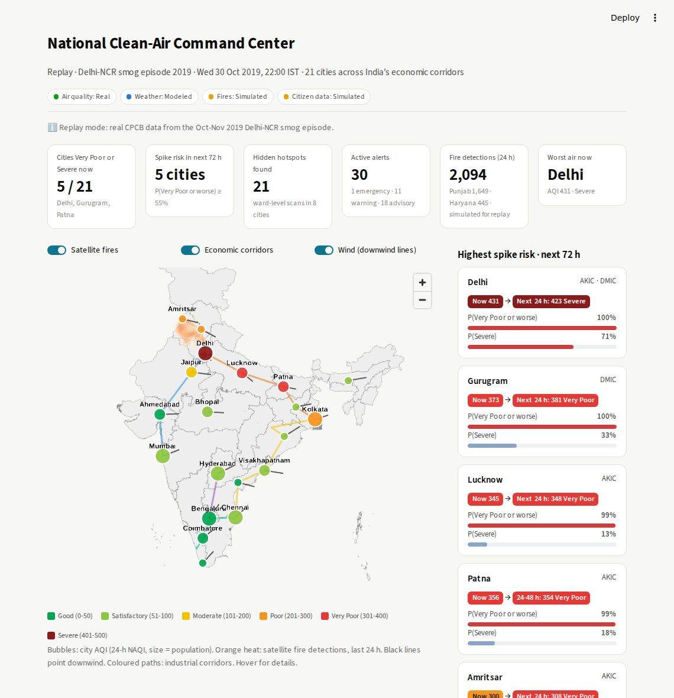
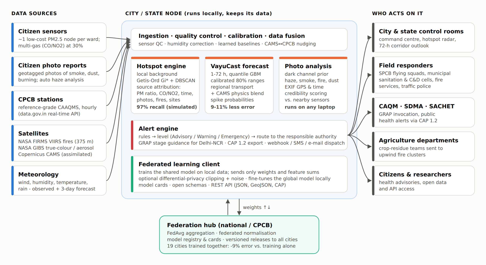
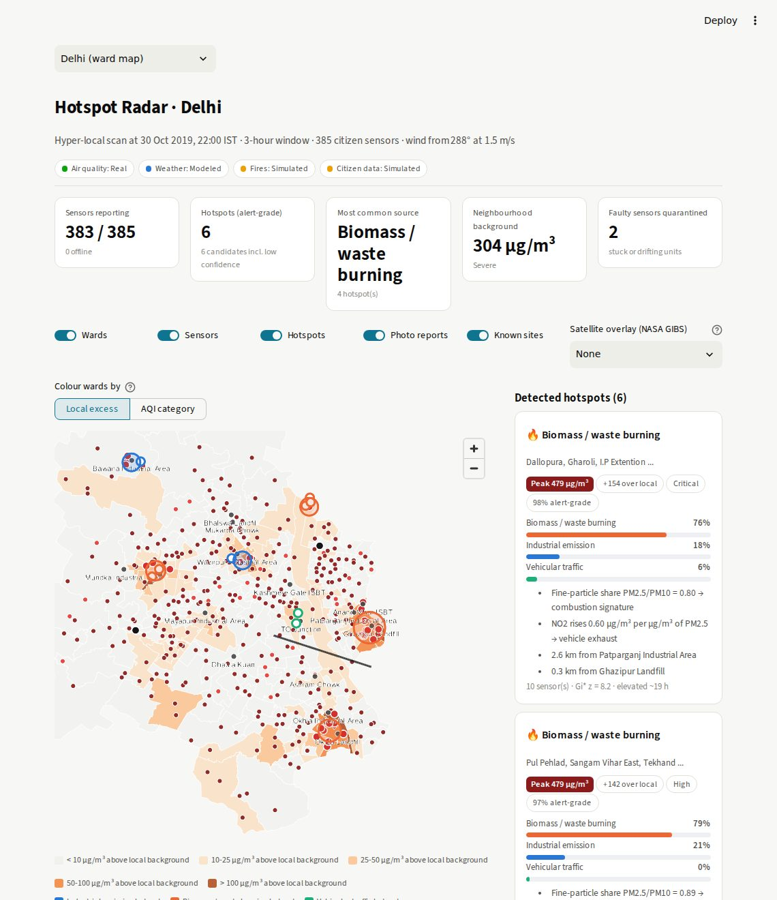
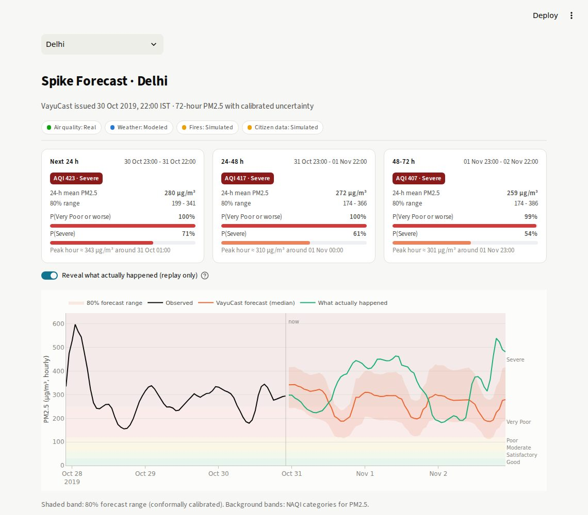

# 🌬️ VayuSetu — federated clean-air intelligence for Indian cities

**Clean Air & Climate Resilience · Theme: Sustainability**

VayuSetu ("air bridge") is an AI platform that finds **hidden, hyper-local pollution hotspots**, **forecasts air-quality
spikes 72 hours ahead** across India's economic corridors, and **alerts the right authority** in a standard format.
It fuses citizen sensors and photos with satellite and weather data. Cities and states **share predictive models
without sharing raw data**, through federated learning.

> 🔗 **Live prototype:** _add your Streamlit link here_  ·  🎥 **Demo video:** _add your YouTube / Drive link here_



---

## The problem

India's air-quality monitoring works at city scale. Reference stations are expensive and sparse, so industrial
emissions, open burning and dust at street level go unseen. According to CREA's 2026 NCAP progress report,
28 of 130 NCAP cities have no continuous monitor at all, and about 40 have no source-apportionment study.
Air pollution is linked to more than 2 million deaths a year in India (State of Global Air 2024).

## What VayuSetu does

| Challenge asks for... | VayuSetu delivers |
|---|---|
| Citizen-sourced data (photos, local sensors) | ~1 low-cost PM2.5 sensor per ward (multi-gas CO/NO₂ at 30% of sites). Photo reports are analysed for haze, smoke, fire and dust, and scored for credibility against nearby sensors |
| Satellite imagery | NASA FIRMS VIIRS fire detections (crop and waste burning, upwind smoke), NASA GIBS true-colour and aerosol overlays, Copernicus CAMS (satellite-assimilated) |
| Meteorological data | Wind for plume direction and upwind fire attribution, humidity for sensor calibration, CAMS physics forecasts blended into the ML forecast |
| Detect hidden hotspots | Robust local background, Getis-Ord Gi\* and DBSCAN clustering, explainable **source attribution** (industrial / burning / dust / traffic) from PM2.5/PM10 ratio, CO/NO₂ fingerprints, time-of-day patterns, photos, fires and known sites |
| Forecast spikes across economic corridors | **VayuCast**: probabilistic 1–72 h PM2.5 forecasts for 26 cities on 5 industrial corridors (AKIC, DMIC, CBIC, HBIC, ECEC), calibrated spike probabilities, GRAP stage guidance for Delhi-NCR |
| Alert authorities for rapid intervention | Rules route each alert to the SPCB, municipal body, traffic police, fire services, CAQM, SDMA or agriculture departments. **CAP 1.2** export (the format of NDMA's SACHET), webhook dispatch and a response log |
| Federated & interoperable | **FedAvg** across city nodes with federated normalisation and optional differential privacy. Model cards, open JSON schemas, GeoJSON, CAP and a REST API |

## Results (honest numbers)

**Forecasting: real CPCB data, 26 cities.** Trained on 2015 to May 2019 and tested on July 2019 to June 2020,
which the model never saw during training. Compared with the strong "next 24 h = last 24 h" persistence baseline:

| Window | VayuCast MAE | Persistence MAE | Error reduction | "Very Poor+" day F1 (model vs persistence) |
|---|---|---|---|---|
| Next 24 h | 12.0 µg/m³ | 13.1 | **-9%** | 0.78 vs 0.76 |
| 24–48 h | 15.9 | 17.6 | **-10%** | 0.72 vs 0.67 |
| 48–72 h | 18.0 | 20.4 | **-11%** | 0.66 vs 0.60 |

- The 80% forecast range contains 82–84% of outcomes (conformally calibrated). Brier score for Very Poor+ days is 0.028.
- Skill is positive in 23 of 26 cities, including cities first seen after training.
- **Delhi backtest.** At 6 pm on 30 Oct 2019, VayuCast gave a **61% chance of Severe air 24–48 h ahead** (it was
  Severe: 425 µg/m³). On 1 Nov, the day a public-health emergency was declared, it gave **94%** for the next day
  (actual: 631 µg/m³).
- Numbers above exclude the COVID-19 lockdown weeks. Including them, the error reductions are 8–10%.

**Hotspot detection.** Delhi, 25-day replay: real CPCB background, simulated local events and sensor faults.

| Network | Sensors | Hidden events found | Alert-grade (≥ 60% confidence) | False alerts/day at alert grade |
|---|---|---|---|---|
| **VayuSetu citizen network** | 385 | **97%** | 86% | **0** |
| Regulatory-density network | 40 | 39% | 25% | 0 |
| City-average monitoring | 1 | 0% | 0% | – |

Correct source type: **88%**. Median time to detection: **2 h**.

**Federated learning: real CPCB data, 19 city nodes.**

- The federated model cuts next-day error by **9% compared with each city training alone**. It is 4% better than
  persistence and within 7% of a model trained on everyone's raw data pooled together.
- A city joining with **14 days of data**:

| City | Training alone | Federated model + fine-tuning |
|---|---|---|
| Lucknow | MAE 25.1 µg/m³ | 16.0 |
| Kolkata | MAE 30.0 µg/m³ | 10.5 |

  Both beat persistence (18.9 and 11.4).
- Differential-privacy noise of σ = 0.5 costs no accuracy (MAE 11.1 vs 11.4).

## Architecture



Every city or state runs a **node** on its own data: ingestion and QC, calibration, the AI engines, and alerting.
A **federation hub** only aggregates model weights and publishes versioned models with cards.

## Screens

| Hotspot Radar (ward level) | Spike Forecast |
|---|---|
|  |  |

Pages: **Command Center** · **Hotspot Radar** · **Spike Forecast** · **Citizen Reports** · **Alerts & Response** ·
**Federated Network** · **Open Data & API**.

## Data: what is real, what is simulated

| Layer | Source | Status |
|---|---|---|
| Ground air quality (training, backtests, replay) | CPCB hourly data for 26 cities, 2015–2020 | **Real** |
| Live air quality + 3-day forecast | Copernicus CAMS via Open-Meteo (no key) | **Real** in Live mode |
| Live ground stations | CPCB real-time via data.gov.in (free key) | **Real** in Live mode, optional |
| Satellite fires | NASA FIRMS VIIRS (open files or free MAP_KEY) | **Real** in Live mode. Synthetic in replay (no 2019 archive bundled) |
| Satellite imagery | NASA GIBS WMS (loaded by the browser) | **Real** |
| Weather | Open-Meteo | **Real** in Live mode. Climatology-based in replay |
| Ward and state boundaries | DataMeet (Survey of India outlines) | **Real** |
| Citizen sensors and photo reports | Pilot network design | **Simulated**, with realistic bias, humidity artefacts, noise, dropouts and faulty units |

The app labels every layer's provenance on screen. The two modes:

- **Replay 2019:** the Delhi-NCR smog episode of Oct–Nov 2019. Works offline, and lets you compare each forecast
  with what really happened.
- **Live:** pulls current data. If a service is unreachable, it falls back to replay automatically.

## Run it locally

```bash
git clone https://github.com/<your-username>/vayusetu.git
cd vayusetu
python -m venv .venv && source .venv/bin/activate      # Windows: .venv\Scripts\activate
pip install -r requirements.txt
streamlit run app.py
```

Optional keys go in `.streamlit/secrets.toml` (see `.streamlit/secrets.toml.example`): `FIRMS_MAP_KEY`,
`DATA_GOV_IN_API_KEY`, `THINGSPEAK_CHANNEL_ID`, `VAYUSETU_WEBHOOK_URL`. Everything works without them.

## Deploy free on Streamlit Community Cloud

1. Push this folder to a **public** GitHub repository.
2. Go to <https://share.streamlit.io>, click **Create app**, choose your repo and branch, and set the main file to `app.py`.
3. Under **Advanced settings**, choose **Python 3.12**. Optionally paste secrets there too.
4. Click **Deploy**. The first build takes a few minutes, and you get a public `*.streamlit.app` link.

## REST API, tests and rebuilding

```bash
pip install -r requirements-dev.txt
uvicorn api.main:app --port 8000        # open http://localhost:8000/docs
pytest -q                               # 35 tests: engines, parsers, alerts, federated, API, all app pages

# Rebuild data & models from raw sources (optional)
python scripts/prepare_data.py --raw-dir <dir with city_hour.csv> --geo-raw-dir <DataMeet files>
python scripts/train_forecaster.py      # ~4 min
python scripts/run_federated.py         # ~30 s
python scripts/evaluate_hotspots.py     # ~2 min
python scripts/export_schemas.py
```

Raw inputs: `city_hour.csv` from the Kaggle dataset *Air Quality Data in India (2015–2020)*, compiled from CPCB.
Boundaries from [datameet/maps](https://github.com/datameet/maps) and
[datameet/Municipal_Spatial_Data](https://github.com/datameet/Municipal_Spatial_Data).

## Hardware (optional citizen node)

A Raspberry Pi and a Nova **SDS011** sensor (about ₹3,000, USB) running `hardware/sds011_node.py` post readings to
ThingSpeak, and the app reads them in. See the *Citizen Reports → Connect a real sensor* tab.

## Project structure

```
app.py                     Streamlit entry point (navigation)
views/                     7 pages
vayusetu/
  config.py                cities, corridors, authorities, landmarks, thresholds
  aqi.py                   India NAQI, categories, GRAP
  engine.py                builds replay/live state, runs all engines
  alerts.py                routing, CAP 1.2 export, dispatch
  data/                    CPCB loader, live connectors, citizen-network simulator
  models/                  forecaster, hotspots, vision, federated, features
  ui.py                    styling, maps, charts, cached data access
api/main.py                FastAPI REST service
hardware/sds011_node.py    Raspberry Pi sensor node
scripts/                   data prep, training, evaluation, schema export
data/                      bundled data, boundaries, trained models, sample photos
reports/                   evaluation outputs
docs/                      architecture, schemas, screenshots
tests/                     pytest suite
```

## Limitations and next steps

- The citizen network is simulated. The next step is a 50-sensor pilot in one district, with co-location against CPCB stations.
- VayuCast v1 has no direct weather inputs; live mode blends in CAMS physics. v2 will train on CAMS and weather history.
- The photo analysis is heuristic (dark channel prior plus colour cues). A small CNN trained on labelled citizen photos is planned.
- Source attribution is rule-based and explainable. Its weights should be calibrated against source-apportionment studies.
- GRAP measures follow the CAQM stages; always verify against the latest CAQM schedule.

## Data & licences

Code: MIT (see `LICENSE`).

- CPCB data: Government of India.
- Copernicus CAMS via Open-Meteo: CC BY 4.0.
- NASA FIRMS and GIBS: open.
- DataMeet boundaries: CC BY 4.0 / CC BY-SA 2.5 IN.

Methods: dark channel prior (He et al., 2009), Getis-Ord Gi\*, DBSCAN, FedAvg (McMahan et al., 2017), DP-FedAvg,
conformal prediction, NAQI (CPCB, 2014), GRAP (CAQM), CAP 1.2 (OASIS).

**Team:** Bhavya Anil, B.Tech Artificial Intelligence & Data Science, Amrita Vishwa Vidyapeetham.
